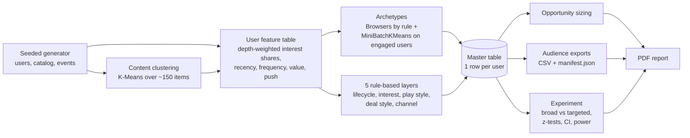
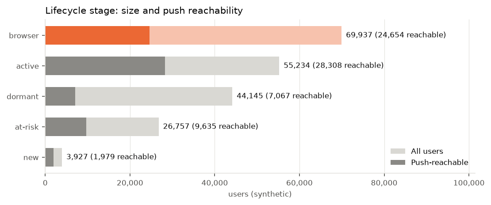
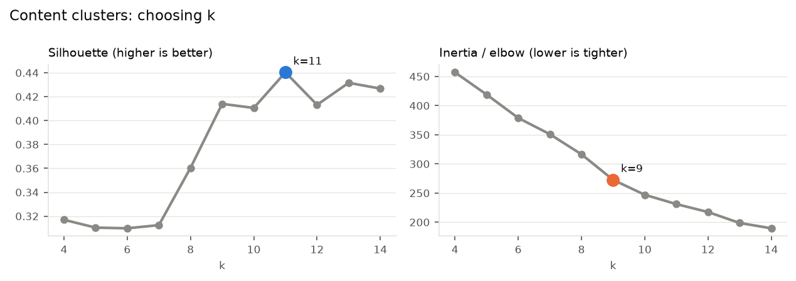
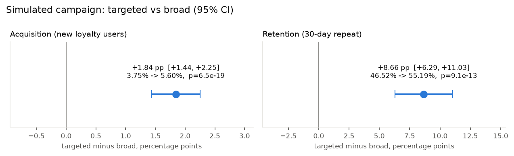

# Loyalty engagement segmentation

[](https://github.com/GerasimoskiDesign/loyalty-engagement-segmentation/actions/workflows/ci.yml)

This project replaces "push everyone" with segment-based targeting for a loyalty program. It clusters the loyalty content, turns each user's behaviour into archetypes plus five rule-based segment layers, and exports campaign-ready audiences. It also includes an A/B readout framework.

Rebuilt from scratch on synthetic data. The production version is proprietary.

## The problem

A mobile operator runs a loyalty hub inside its app, with games, raffles and partner vouchers. Most push campaigns go to everyone, which wears out users who don't care and misses the ones who would respond to the right offer. The team needs groups of users that are named, sized and push-reachable, which campaign managers can act on and explain. It also needs a sound way to check that targeting beats a broad send.

## What this does



1. **Content clustering**: catalog items (game, offer and raffle; category; frequency; value; effort; discount; partner tier) are one-hot encoded and scaled, then clustered with K-Means. k comes from silhouette, with the elbow plotted as a cross-check. Each cluster gets a deterministic name from its centroid, for example "High-value tech offers" or "Daily casual games".
2. **User features**: each user's share of interactions per content cluster, weighted by action depth (view 1, play 2, unlock 3, redeem 5). On top of that: recency, active days per 30 observable days, redeemed value, discount-depth preference, push open rate, and the loyalty share of app activity.
3. **Archetypes**: users with no loyalty actions are labelled *Browsers* by rule. Engaged users go through StandardScaler, then PCA (95% variance), then MiniBatchKMeans. k is chosen using silhouette (on a 20k sample), Davies-Bouldin, and stability across 5 seeds (mean pairwise adjusted Rand index). Clusters are profiled and named by ordered rules.
4. **Five layers** (every user gets exactly one label per layer, and all thresholds are in [`config/segments.yaml`](config/segments.yaml)):
   - lifecycle: new / active / at-risk / dormant / browser
   - interest: dominant content cluster / mixed / none
   - play style: repeat player / collector / one-and-done / non-player
   - deal style: high-value seeker / any-deal / non-redeemer
   - channel: reachable-responsive / reachable-unresponsive / not reachable
5. **Opportunity sizing**: size, push-reachable size and shares for every layer and for key combinations.
6. **Audiences** ([`config/audiences.yaml`](config/audiences.yaml)): match, then keep only reachable users, then dedupe within and across audiences, then remove anyone pushed in the last N days, then apply an optional seeded size cap. Output is one CSV per audience plus a `manifest.json` with the count after each step, the config hash and the as-of date.
7. **Experiment**: reachable users are randomised into a broad arm (generic push) and a targeted arm (a message per interest segment, with onboarding for Browsers). Acquisition and 30-day repeat engagement are compared with a two-proportion z-test and 95% CI. Power and minimum-sample-size helpers support planning the next test.
8. **Report**: a 6-page PDF (matplotlib + ReportLab) and a [walkthrough notebook](notebooks/walkthrough.ipynb).

## Results on synthetic data

> All numbers below come from `python -m loyaltyseg all` with the defaults: 200,000 synthetic users, seed 42, as-of 2026-08-31, 10.8M events. They describe the synthetic generator, not any real customer base.

**Headline: the Browsers.** 69,937 users (35.0%) open the app but have never touched the loyalty hub. 24,654 of them are push-reachable, which is 34.4% of everyone we can reach. That makes them the largest single growth opportunity.



| Lifecycle | Users | % of base | Push-reachable | % reachable |
|---|---:|---:|---:|---:|
| browser | 69,937 | 35.0% | 24,654 | 35.3% |
| active | 55,234 | 27.6% | 28,308 | 51.3% |
| dormant | 44,145 | 22.1% | 7,067 | 16.0% |
| at-risk | 26,757 | 13.4% | 9,635 | 36.0% |
| new | 3,927 | 2.0% | 1,979 | 50.4% |
| **all users** | **200,000** | | **71,643** | **35.8%** |

**Content clusters.** Silhouette picks k = 11 (silhouette 0.44; the elbow is at k = 9):
Daily casual games, Mixed challenge games, High-value tech offers, Mid-value shopping offers, Everyday food offers, High-value travel offers, Everyday entertainment offers, Mid-value fitness offers, and Tech, Travel and Entertainment prize raffles.



**Archetypes.** The k scan over engaged users picks k = 6. It is stable (mean pairwise ARI 0.97 across 5 seeds), and among the stable candidates (k = 3, 5, 6, 7) it has the best silhouette (0.22) and the best Davies-Bouldin (1.68). Adding the rule-based Browsers gives 7 archetypes, and the naming rules recover all 7 planted names:

| Archetype | Users | Share | Active days / 30d (median) | Recency, days (median) | Game share | Tech share | Shopping share | Discount pref | Push open rate |
|---|---:|---:|---:|---:|---:|---:|---:|---:|---:|
| Browsers | 69,937 | 35.0% | 0.00 | none | 0.00 | 0.00 | 0.00 | 0.00 | 0.03 |
| Dormant | 33,093 | 16.5% | 0.58 | 208 | 0.19 | 0.16 | 0.11 | 0.34 | 0.02 |
| Occasional Players | 30,371 | 15.2% | 0.41 | 54 | 0.22 | 0.31 | 0.03 | 0.17 | 0.05 |
| Gamers | 20,072 | 10.0% | 3.04 | 7 | 0.74 | 0.08 | 0.02 | 0.30 | 0.18 |
| Deal Hunters | 16,758 | 8.4% | 1.97 | 15 | 0.01 | 0.06 | 0.10 | 0.47 | 0.13 |
| Shoppers | 15,114 | 7.6% | 1.65 | 17 | 0.07 | 0.06 | 0.70 | 0.32 | 0.10 |
| Tech Chasers | 14,655 | 7.3% | 1.64 | 16 | 0.07 | 0.76 | 0.03 | 0.32 | 0.09 |

**Recovery of the planted archetypes: ARI = 0.902.** Rows are the archetypes found, columns are the planted ones:

| found \ planted | Browsers | Deal Hunters | Dormant | Gamers | Occasional | Shoppers | Tech Chasers |
|---|---:|---:|---:|---:|---:|---:|---:|
| Browsers | **69,937** | 0 | 0 | 0 | 0 | 0 | 0 |
| Deal Hunters | 0 | **15,981** | 257 | 20 | 88 | 271 | 141 |
| Dormant | 0 | 1,117 | **27,325** | 208 | 2,607 | 948 | 888 |
| Gamers | 0 | 70 | 7 | **18,997** | 626 | 175 | 197 |
| Occasional Players | 0 | 50 | 1,772 | 775 | **26,368** | 365 | 1,041 |
| Shoppers | 0 | 453 | 210 | 19 | 109 | **14,232** | 91 |
| Tech Chasers | 0 | 186 | 349 | 23 | 199 | 153 | **13,745** |

Most of the confusion is between Dormant and Occasional Players, and between Dormant and the light users of every other archetype. That is expected: a light Shopper whose last redemption was 4 months ago really does look lapsed. **Real data has no ground truth**, so this check is only possible here. On production data the guard rails are stability across seeds and whether the campaign team can recognise and use the groups. This is why k selection requires stability before it looks at geometry.

**Campaign audiences** (as of 2026-08-31, 7-day exclusion window):

| Audience | Matched | Reachable | After dedupe | After exclusion | Exported |
|---|---:|---:|---:|---:|---:|
| reachable_browsers | 69,937 | 24,654 | 24,654 | 23,444 | 23,444 |
| at_risk_deal_hunters | 4,151 | 1,738 | 1,738 | 1,651 | 1,651 |
| tech_chasers | 13,257 | 6,031 | 6,031 | 5,740 | 5,740 |
| shoppers | 13,795 | 6,353 | 6,353 | 6,045 | 6,045 |
| active_gamers | 16,546 | 9,290 | 9,290 | 8,801 | 8,801 |
| high_value_redeemers | 16,118 | 7,536 | 1,294 | 915 | 915 |

`high_value_redeemers` overlaps the tech and shopping audiences on purpose. Cross-audience dedupe means nobody gets two pushes from one run.

**Experiment readout (simulated).** 71,643 reachable users were split at random into two arms:

| Metric | Broad | Targeted | Difference | 95% CI | p-value |
|---|---:|---:|---:|---:|---:|
| Acquisition: users with no loyalty activity in the prior 30 days who engaged | 783 / 20,860 (3.75%) | 1,147 / 20,496 (5.60%) | +1.84 pp | [+1.44, +2.25] pp | 7e-19 |
| Retention: responders who engaged again within 30 days | 1,312 / 2,820 (46.5%) | 2,357 / 4,271 (55.2%) | +8.66 pp | [+6.29, +11.03] pp | 9e-13 |



Planning helper: detecting a 10% relative lift on the 3.75% acquisition baseline (alpha 0.05, power 0.80) needs 42,180 users per arm. At the current 20.5k per arm, the minimum detectable effect is +0.54 pp.

> **Read this before quoting the experiment.** The outcomes are drawn from the generator's own latent response model (`src/loyaltyseg/latent.py`), and that model assumes relevant messages work better. The result therefore reflects the generator's parameters. It shows that the randomisation, metrics, tests and confidence intervals work end to end. It is **not** evidence that targeting works.

## Production context

The production version targeted push campaigns for a loyalty program of 800k+ users; the market was rated best in its group for cost-efficient campaign targeting.

## Quickstart

Requires Python 3.11+. A full run with 200k users takes about 3 minutes on a laptop. With `--users 800000` it takes about 4.5 minutes.

**Windows PowerShell**

```powershell
git clone https://github.com/GerasimoskiDesign/loyalty-engagement-segmentation.git
cd loyalty-engagement-segmentation
python -m venv .venv
.\.venv\Scripts\Activate.ps1
python -m pip install --upgrade pip
pip install -e ".[dev]"
python -m loyaltyseg all
pytest
```

**macOS / Linux**

```bash
git clone https://github.com/GerasimoskiDesign/loyalty-engagement-segmentation.git
cd loyalty-engagement-segmentation
python3 -m venv .venv
source .venv/bin/activate
python -m pip install --upgrade pip
pip install -e ".[dev]"
python -m loyaltyseg all
pytest
```

Outputs go to `outputs/`: the PDF in `outputs/report/`, the audiences in `outputs/audiences/as_of_<date>/`, and the master table in `outputs/segments/master.parquet`. Each step can also be run on its own:

```text
python -m loyaltyseg generate   --users 200000 --seed 42 --as-of 2026-08-31
python -m loyaltyseg content | features | archetypes | segments
python -m loyaltyseg audiences  --exclusions data/raw/contact_history.csv
python -m loyaltyseg experiment
python -m loyaltyseg report     --docs-img     # also refreshes the README charts
```

Optional settings (log level, data, output and config folders) can go in a `.env` file. See `.env.example`.

## Project structure

```text
loyalty-engagement-segmentation/
├── config/
│   ├── pipeline.yaml        # k ranges, feature lists, action depths, experiment settings
│   ├── segments.yaml        # every threshold of the five layers
│   └── audiences.yaml       # campaign audience definitions
├── data/GENERATOR.md        # generator assumptions (generated data is git-ignored)
├── docs/img/                # README charts
├── notebooks/walkthrough.ipynb
├── src/loyaltyseg/
│   ├── cli.py, __main__.py  # python -m loyaltyseg <command>
│   ├── config.py, io.py     # settings, parquet/json helpers, dataset fingerprint
│   ├── latent.py            # hidden generator parameters (generator + simulation only)
│   ├── generate.py          # seeded synthetic users, catalog, events
│   ├── content.py           # catalog features, k selection, K-Means, cluster naming
│   ├── features.py          # per-user feature table (part-by-part aggregation)
│   ├── archetypes.py        # scaler/PCA/MiniBatchKMeans, k scan, naming, ARI evaluation
│   ├── segments.py          # five rule-based layers + master table
│   ├── opportunity.py       # sizing tables, Browser highlight
│   ├── audiences.py         # filter chain, CSV exports, manifest
│   ├── stats.py             # two-proportion z-test, CI, sample size, MDE
│   ├── experiment.py        # broad vs targeted simulation + readout
│   ├── charts.py, report.py # matplotlib figures, ReportLab PDF
│   └── pipeline.py          # step orchestration
├── tests/                   # 52 pytest tests
├── .github/workflows/ci.yml # ruff + pytest
└── pyproject.toml
```

## Design decisions & trade-offs

- **Browsers are labelled by rule and kept out of the clustering.** A user with zero loyalty actions has an all-zero interest vector, so there is nothing to cluster. In a first version that put everyone into K-Means, the 35% point mass absorbed a centroid and distorted the scaler, and the engaged archetypes came out unstable (seed-to-seed ARI mostly 0.75 to 0.87, so no k reliably passed the stability bar).
- **Frequency and value are measured per 30 days the user could have been active.** Raw 12-month counts made every recent sign-up look "light", so the clusters split users by tenure instead of by behaviour.
- **Interest shares are smoothed** towards the population mix with a weight of 6 depth points (empirical-Bayes style). Without this, a user with two clicks gets a "100% travel raffles" profile, and those noisy profiles made k selection unstable.
- **Each MiniBatchKMeans fit keeps the best of 8 runs by full-data inertia.** The built-in `n_init` compares starting points on a small sample and too often kept a poor local optimum. This gave one of the largest stability gains.
- **k must be stable first, then geometrically good.** Silhouette and Davies-Bouldin both drift towards larger k on this data, so only k values with a mean pairwise ARI of at least 0.85 across 5 seeds are considered. Among those, the best average rank of the two geometric scores wins. Above 150k engaged users, the k scan runs on a seeded sample and the final model uses everyone.
- **Names come from ordered rules, not from a person.** This is reproducible and auditable. However, I wrote the naming rules knowing which behaviours the generator plants. On real data the names need a review session with the campaign team.
- **"Dormant" means two different things.** The archetype describes how someone behaved over the year. The lifecycle label applies a hard 90-day recency rule. That is why there are 33k Dormant archetype users but 44k lifecycle-dormant users. Both are useful, but the difference must be explained when the numbers are presented.
- **Browser wins over "new" in the lifecycle layer.** This keeps the Browser label exactly equal to its definition (app opens > 0 and zero loyalty events), and the tests check this against the raw events. The cost is that a 10-day-old user who has never visited the hub is reported as a Browser, not as new.
- **Reachability needs an app open in the last 30 days**, on top of push opt-in and being in the country. A device that has not opened the app in a month probably has a stale push registration, and counting it would inflate every audience.
- **Audience exports leave out phone numbers** (data minimisation). The push provider only needs the user id. The size cap uses a seeded random sample, not "most engaged first", so a capped audience stays representative and can carry a holdout.
- **The experiment is a simulation and has known limitations.** Outcomes come from the generator's latent model, so the lift is built in. Retention is measured among responders, and the two arms have different responder populations, so the retention difference mixes the treatment effect with a change in who responded. An intention-to-treat retention metric (repeat engagement per assigned user) would be the cleaner primary metric for a real test.
- **Scale.** Events are written and aggregated in 50k-user partitions, so 800k users (43M events) runs in about 4.5 minutes with flat memory. Beyond that, the next steps would be DuckDB or Spark for the aggregation and a scheduled job instead of a CLI.
- **What I'd do next:** compare against Gaussian mixtures or HDBSCAN for the diffuse low-activity groups; track segment drift month over month (label transition matrix and stability against last month's model); add a persistent holdout and sequential testing for real campaigns; try uplift modelling to choose *who* to target, not only *what* to send them.

## Tech stack

Python 3.11 · pandas · NumPy · PyArrow (Parquet) · scikit-learn (K-Means, MiniBatchKMeans, PCA, silhouette, Davies-Bouldin, ARI) · SciPy · matplotlib · ReportLab · PyYAML · python-dotenv · pytest · statsmodels (test reference) · ruff · GitHub Actions
